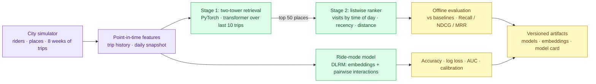

# ride-sharing-ai-recommendations

Rider recommendations for a ride-share app: when a rider opens the app, predict **where they're going** ("Where to?")
and **which ride mode they'll pick** (Wait & Save, Standard, XL, Lux), in real time.

A two-stage recommender (**PyTorch two-tower retrieval** with a transformer over trip history, then a **listwise
neural ranker**), plus a **DLRM-style** ride-mode conversion model. It's trained on a synthetic city and evaluated
offline against the baselines a real team would have to beat.

> Independent portfolio project. All data is synthetic; no real rider, trip or company data is used.

## Results (test week, 5,000 riders, 385k trips)

**"Where to?"** (one true destination per trip, ranked over ~1,200 places)

| Model | Recall@1 | Recall@3 | Recall@10 | NDCG@10 | MRR |
|---|---|---|---|---|---|
| Popularity | 0.013 | 0.034 | 0.079 | 0.041 | 0.040 |
| Rider's most-visited places | 0.629 | 0.831 | 0.943 | 0.790 | 0.742 |
| Rider's most-visited at this time of day | 0.673 | 0.894 | 0.944 | 0.825 | 0.787 |
| Two-tower retrieval | 0.740 | 0.836 | 0.909 | 0.823 | 0.800 |
| **Two-tower + ranker** | **0.824** | **0.936** | **0.953** | **0.899** | **0.881** |

The first suggestion is right **82%** of the time, versus 67% for the strongest heuristic (**+22% relative**).

**Ride mode**

| Model | Accuracy | Log loss | Macro AUC | ECE |
|---|---|---|---|---|
| Global mode mix | 0.517 | 1.184 | 0.560 | 0.011 |
| Rider's own history (smoothed) | 0.558 | 1.037 | 0.749 | 0.014 |
| **DLRM** | **0.568** | **1.013** | **0.761** | **0.006** |

Ride mode is noisy by design: choices are sampled from a random-utility model. The gain comes from combining the
rider's history with context the heuristic can't see (group size, luggage, surge, quoted prices). The model is also
the best calibrated (lowest ECE), which matters because the probabilities feed pricing and ranking.

Each run writes `metrics.json` and a `model_card.md` with the full numbers, training curves and feature importance.

## How it works



| Piece | File | What it does |
|---|---|---|
| City simulator | [`simulator.py`](ml/src/rideshare_recs/simulator.py) | Five rider segments (commuter, student, nightlife, business, family) with commutes, gym and lunch habits, weekend errands, nightlife, airport trips and exploration. Prices and surge by time and distance; ride mode from a random-utility model (price sensitivity, group size, luggage, persona tastes). |
| Features | [`features.py`](ml/src/rideshare_recs/features.py) | Last 10 destinations before each trip, plus a **daily batch snapshot** (visits per place by time of day and weekday/weekend, recency, popularity, category-by-hour lift). One function builds features for training and for a single online request, so training and serving can't skew. |
| Two-tower retrieval | [`two_tower.py`](ml/src/rideshare_recs/models/two_tower.py) | Query tower: rider, origin, hour, day, segment, and a **transformer encoder over trip history** (SASRec-style). Item tower: place, category, location. L2-normalised dot product with a learned temperature; exact softmax over the ~1.2k-place catalogue. |
| Ranker | [`ranker.py`](ml/src/rideshare_recs/models/ranker.py) | **Listwise** softmax loss over the 50 candidates per query, MLP over 13 features plus a category embedding. Permutation importance explains it. |
| Ride-mode model | [`ride_mode.py`](ml/src/rideshare_recs/models/ride_mode.py) | **DLRM**: sparse embeddings plus a dense bottom MLP, pairwise dot-product interactions, top MLP. Modes too small for the group are masked out, not just ranked lower. |
| Evaluation | [`evaluation.py`](ml/src/rideshare_recs/evaluation.py) | Recall@K, NDCG@10, MRR (ties counted half, so constant scorers get no credit); accuracy, log loss, macro AUC, expected calibration error. |
| Pipeline | [`train.py`](ml/src/rideshare_recs/train.py) | Simulate → features → train → evaluate → versioned artifact directory with `LATEST` pointer. |

### Decisions worth defending

- **Split by time, never at random.** Weeks 1–6 train retrieval, week 7 trains the ranker, week 8 is the test. A
  random split would leak a rider's future habits into training and inflate every number.
- **The ranker trains on a different week than retrieval.** Otherwise it learns to trust retrieval scores that are
  overconfident on data the retrieval model has already memorised.
- **Point-in-time features.** History holds only earlier trips. The batch snapshot holds only data before the
  query's week, matching what a nightly pipeline would have published. Tests enforce both.
- **Strong baselines first.** "Most-visited at this time of day" already reaches 67% Recall@1, so a model is only
  worth shipping if it beats that, not popularity.
- **Two stages.** Retrieval is cheap enough to score every place (with an ANN index at real scale). The ranker
  spends richer features on just 50 candidates. The retrieval ceiling (recall@50 ≈ 0.95) is reported, because the
  ranker can't recover what retrieval misses.
- **Exact softmax here, sampled softmax at scale.** With ~1.2k places the full softmax is cheap and exact. With
  millions of items, the same towers would train with in-batch negatives and logQ correction.

## Run it

Requires [uv](https://docs.astral.sh/uv/) (it installs Python 3.12 and the dependencies).

```bash
cd ml
uv sync
uv run rideshare-train                # full run, about 2 minutes on a laptop CPU
uv run rideshare-train --riders 800   # quick run, about 15 seconds
uv run pytest -q
```

Outputs land in `ml/artifacts/<version>/` (git-ignored): `two_tower.pt`, `place_embeddings.npy`, `ranker.pt`,
`ride_mode.pt`, `places.parquet`, `metrics.json`, `model_card.md`. Simulated data is cached in `ml/data/`.

## Roadmap

1. ✅ **ML core:** simulator, two-tower retrieval, listwise ranker, DLRM ride-mode model, offline evaluation
2. **Real-time serving:** FastAPI inference service, Redis online feature store, p95 latency budget, A/B
   experiment assignment and a significance-testing simulator
3. **Product:** Go API gateway, React rider app, Docker Compose, Prometheus/Grafana model and latency monitoring,
   drift checks
4. **LLM layer:** Claude explains suggestions ("You usually go to the gym after work on Tuesdays") and handles
   free-text requests, with a timeout fallback to the ranked list

## Troubleshooting

- **`ModuleNotFoundError: No module named 'rideshare_recs'` on macOS:** iCloud Desktop sync can mark the
  editable-install `.pth` file as hidden, and Python skips hidden `.pth` files. Fix:
  `chflags nohidden ml/.venv/lib/python3.12/site-packages/*.pth`
