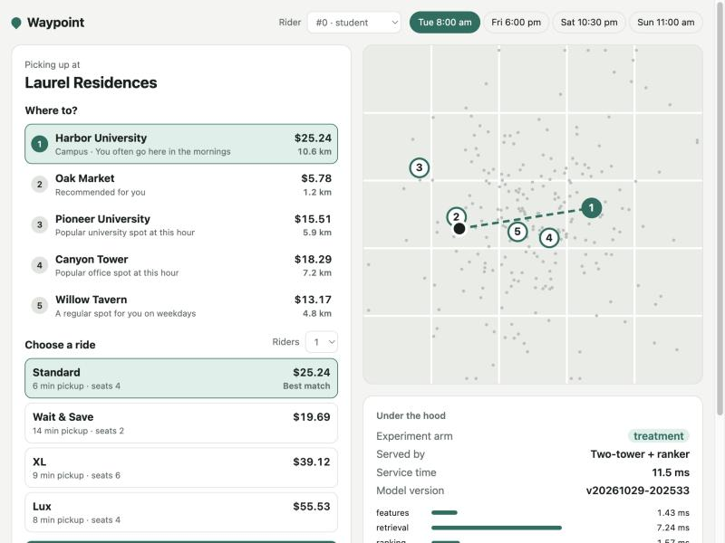
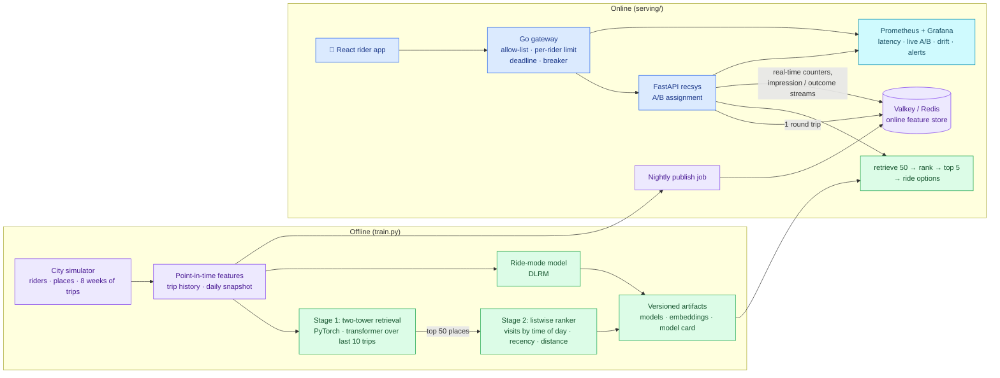
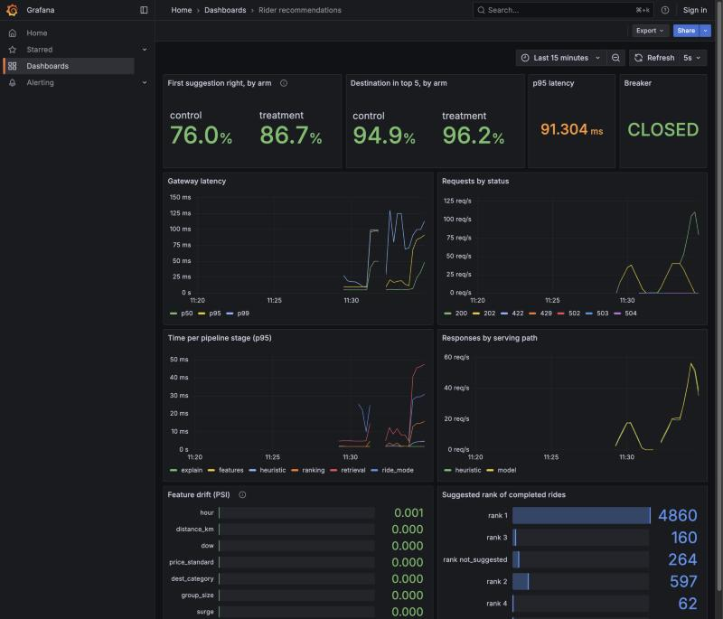

# ride-sharing-ai-recommendations

Rider recommendations for a ride-share app: when a rider opens the app, predict **where they're going** ("Where to?")
and **which ride mode they'll pick** (Wait & Save, Standard, XL, Lux), in real time.

A two-stage recommender (**PyTorch two-tower retrieval** with a transformer over trip history, then a **listwise
neural ranker**) and a **DLRM-style** ride-mode conversion model. They're trained on a synthetic city, evaluated
offline against strong baselines, and served by a **FastAPI** service with a **Redis online feature store** and
**A/B experiments**, behind a **Go API gateway**. A **React** rider app and **Prometheus/Grafana** monitoring with
drift checks complete the product.

> Independent portfolio project. All data is synthetic; no real rider, trip or company data is used. The demo app's
> "Waypoint" brand is fictional.



## Results (test week, 5,000 riders, 385k trips)

**"Where to?"** (one true destination per trip, ranked over ~1,200 places)

| Model | Recall@1 | Recall@3 | Recall@10 | NDCG@10 | MRR |
|---|---|---|---|---|---|
| Popularity | 0.013 | 0.034 | 0.079 | 0.041 | 0.040 |
| Rider's most-visited places | 0.629 | 0.831 | 0.943 | 0.790 | 0.742 |
| Rider's most-visited at this time of day | 0.673 | 0.894 | 0.944 | 0.825 | 0.787 |
| Two-tower retrieval | 0.739 | 0.836 | 0.905 | 0.822 | 0.798 |
| **Two-tower + ranker** | **0.823** | **0.935** | **0.951** | **0.897** | **0.879** |

The first suggestion is right **82%** of the time, versus 67% for the strongest heuristic (**+22% relative**).

**Ride mode**

| Model | Accuracy | Log loss | Macro AUC | ECE |
|---|---|---|---|---|
| Global mode mix | 0.517 | 1.184 | 0.560 | 0.011 |
| Rider's own history (smoothed) | 0.558 | 1.037 | 0.749 | 0.014 |
| **DLRM** | **0.568** | **1.013** | **0.761** | **0.006** |

Ride mode is noisy by design: choices are sampled from a random-utility model. The gain comes from combining the
rider's history with context the heuristic can't see (group size, luggage, surge, quoted prices). The model is also
the best calibrated (lowest ECE), which matters because the probabilities feed pricing and ranking.

**A/B experiment** (test week replayed with the service's rider-level assignment; `uv run rideshare-abtest`)

| Metric | Control (heuristic) | Treatment (two-stage) | Relative lift (95% CI) | p |
|---|---|---|---|---|
| Destination was the first suggestion | 0.674 | 0.821 | **+21.8%** (+20.8% to +22.9%) | < 1e-100 |
| Destination in the top 3 | 0.895 | 0.936 | **+4.6%** (+4.1% to +5.1%) | 3e-65 |

- **Sample-ratio check:** passes (p = 0.63, 2,476 vs 2,510 riders).
- **A/A calibration:** 500 random control-vs-control splits reject at **4.2%**, against the expected 5%.
- **Power:** the minimum detectable effect is 1.5% relative at 80% power. About 11.6k riders would be needed to
  detect a 1% lift.

**Live replay** (3,600 test-week trips sampled across the week, through the gateway with `rideshare-replay`): first
suggestion right **67.1% control, 80.7% treatment**, in line with the offline readout above.

Each training run writes `metrics.json` and a `model_card.md` (full numbers, training curves, feature importance).
The A/B readout writes `ab_test.json`.

## How it works



### Models and offline pipeline

| Piece | File | What it does |
|---|---|---|
| City simulator | [`simulator.py`](ml/src/rideshare_recs/simulator.py) | Five rider segments (commuter, student, nightlife, business, family) with commutes, gym and lunch habits, weekend errands, nightlife, airport trips and exploration. Prices and surge by time and distance; ride mode from a random-utility model (price sensitivity, group size, luggage, persona tastes). |
| Features | [`features.py`](ml/src/rideshare_recs/features.py) | Last 10 destinations before each trip, plus a **daily batch snapshot** (visits per place by time of day and weekday/weekend, recency, popularity, category-by-hour lift). There's a pandas version for training and a NumPy fast path for serving; a parity test pins them together. |
| Two-tower retrieval | [`two_tower.py`](ml/src/rideshare_recs/models/two_tower.py) | Query tower: rider, origin, hour, day, segment, and a **transformer encoder over trip history** (SASRec-style). Item tower: place, category, location. L2-normalised dot product with a learned temperature; exact softmax over the ~1.2k-place catalogue. |
| Ranker | [`ranker.py`](ml/src/rideshare_recs/models/ranker.py) | **Listwise** softmax loss over the 50 candidates per query, MLP over 13 features plus a category embedding. Permutation importance explains it. |
| Ride-mode model | [`ride_mode.py`](ml/src/rideshare_recs/models/ride_mode.py) | **DLRM**: sparse embeddings plus a dense bottom MLP, pairwise dot-product interactions, top MLP. Modes too small for the group are masked out, not just ranked lower. |
| Evaluation | [`evaluation.py`](ml/src/rideshare_recs/evaluation.py) | Recall@K, NDCG@10, MRR (ties counted half, so constant scorers get no credit); accuracy, log loss, macro AUC, expected calibration error. |
| Pipeline | [`train.py`](ml/src/rideshare_recs/train.py) | Simulate → features → train → evaluate → versioned artifact directory with `LATEST` pointer. |
| A/B readout | [`ab_test.py`](ml/src/rideshare_recs/ab_test.py) | Replays the test week by experiment arm; delta-method SE clustered by rider, SRM check, power and MDE, A/A calibration. |

### Serving

| Piece | File | What it does |
|---|---|---|
| API | [`serving/app.py`](ml/src/rideshare_recs/serving/app.py) | `POST /v1/recommendations`, `POST /v1/ride-options`, `POST /v1/events/ride-completed`, `GET /v1/riders/{id}`, `GET /v1/places`, `/health/live`, `/health/ready`, `/metrics`; `X-Model-Version` on every response |
| Recommender | [`serving/recommender.py`](ml/src/rideshare_recs/serving/recommender.py) | Features in one Redis round trip → two-tower query embedding · cached place embeddings → top 50 → ranker → top 5 with plain-language reasons → ride options with prices, pickup ETA and pick probability |
| Feature store | [`serving/feature_store.py`](ml/src/rideshare_recs/serving/feature_store.py) | Redis (Valkey locally, Memorystore on GCP) or in-memory. Batch snapshot per rider plus real-time recent trips and mode counters; impression and outcome streams for experiment analysis |
| Publish job | [`serving/publish.py`](ml/src/rideshare_recs/serving/publish.py) | Nightly batch: computes the snapshot as of a cutoff day and writes it to the store (meta written last, so readers never see a half-published snapshot) |
| Experiments | [`serving/experiments.py`](ml/src/rideshare_recs/serving/experiments.py) | Sticky rider-level assignment by `sha256(experiment:rider)`: no assignment table, the same answer on every pod, independent across experiments |
| Benchmark | [`serving/bench.py`](ml/src/rideshare_recs/serving/bench.py) | Async load test with random riders, pickup points and times; reports p50 / p95 / p99 and throughput |

### Gateway, rider app and monitoring

| Piece | Where | What it does |
|---|---|---|
| Go gateway | [`gateway/`](gateway/gateway.go) | The only public entry. Allow-listed routes (`/metrics` and `/docs` return 404), per-rider token bucket (20/s, burst 40) with 429 and `Retry-After`, 250 ms upstream deadline, circuit breaker with a trial request, 64 KB body limit, request IDs, JSON logs, metrics on a separate admin port |
| Rider app | [`web/`](web/src/App.tsx) | React + TypeScript: pick a rider and moment, see suggestions with reasons on a city map, choose a ride, and request it. Booking updates real-time features, so the next suggestions change. An "Under the hood" panel shows the experiment arm, the serving path and the time per stage |
| Replay | [`serving/replay.py`](ml/src/rideshare_recs/serving/replay.py) | Replays test-week trips through the gateway as app usage: asks for suggestions, then completes the real trip. This drives the live A/B panels |
| Dashboards and alerts | [`monitoring/`](monitoring/alerts.yml) | Grafana dashboard (live first-suggestion rate by arm, latency, stage timing, serving path, breaker, PSI) and Prometheus alerts for latency, error rate, an open breaker, fallback rate and drift |
| Drift report | [`drift.py`](ml/src/rideshare_recs/drift.py) | Population Stability Index per feature, training weeks vs recent traffic, exposed as a metric. `--simulate-shift` injects a demand shock to prove the alarm fires |



**Failure behaviour, tested by stopping containers:**

| Failure | What the rider gets |
|---|---|
| Unknown rider | 200: places popular at this hour near the pickup (`path: cold_start`) |
| Valkey down | 200 with 5 suggestions from popularity (`path: fallback_no_features`); `/health/ready` returns 503 |
| Recommendation service down | 502 for the first 5 calls, then the breaker opens and answers 503 immediately |
| Service too slow | 504 at the 250 ms deadline |
| Analytics logging fails | The request still succeeds |

Valkey runs without persistence in this stack, so after it restarts, re-run `docker compose up publish-features`.

**Latency** (one service container, Docker Desktop on an M-series Mac, client-side):

| Path | Load | p50 | p95 | p99 | Throughput |
|---|---|---|---|---|---|
| Direct to the service | 1 at a time | 5.7 ms | 7.2 ms | 8.0 ms | 177 req/s |
| Direct to the service | 8 concurrent | 31 ms | 51 ms | 82 ms | 244 req/s |
| Through the gateway | 1 at a time | 8.6 ms | 11.3 ms | 18 ms | 114 req/s |
| Through the gateway | 8 concurrent | 56 ms | 87 ms | 111 ms | 146 req/s |

The direct and gateway runs were separate, on a busy laptop, so treat the gap as indicative. The service container
runs one CPU-bound process, so you scale by adding replicas. The first version built ranker features with pandas and
ran at 12 ms p50. The NumPy fast path halved that, and the parity test proves it produces the same features the
ranker was trained on.

Example:

```bash
curl -s -X POST localhost:8090/v1/recommendations -H 'content-type: application/json' \
  -d '{"rider_id": 7, "origin": {"x_km": 8, "y_km": 12}, "at": "2026-10-23T22:30:00"}'
```
```json
{
  "experiment": {"name": "where_to_two_stage_v1", "variant": "treatment"},
  "path": "model",
  "destinations": [
    {"name": "Bayview Tavern 2 · Downtown", "category": "bar", "distance_km": 5.6, "standard_fare": 17.27,
     "reasons": ["You often go here in the late nights", "Your most recent destination"]},
    {"name": "Willow Tavern · Downtown", "category": "bar", "distance_km": 4.4, "standard_fare": 14.39,
     "reasons": ["You often go here in the late nights"]}
  ],
  "ride_options": {"recommended": "standard",
                   "options": [{"mode": "standard", "price": 17.27, "pickup_minutes": 6, "probability": 0.4075}]},
  "timings_ms": {"features": 0.018, "retrieval": 0.273, "ranking": 0.17, "explain": 0.315}
}
```
(trimmed to 2 of 5 destinations and 1 of 4 ride options; in-process timings with the in-memory store)

### Decisions worth defending

- **Split by time, never at random.** Weeks 1–6 train retrieval, week 7 trains the ranker, week 8 is the test. A
  random split would leak a rider's future habits into training and inflate every number.
- **The ranker trains on a different week than retrieval.** Otherwise it learns to trust retrieval scores that are
  overconfident on data the retrieval model has already memorised.
- **Point-in-time features.** History holds only earlier trips. The batch snapshot holds only data before the
  query's week, matching what the nightly publish job serves. Tests enforce both, and the parity test checks that
  serving computes the same values.
- **Strong baselines first.** "Most-visited at this time of day" already reaches 67% Recall@1, so a model is only
  worth shipping if it beats that, not popularity. It's also the A/B control arm.
- **Two stages.** Retrieval is cheap enough to score every place (with an ANN index at real scale). The ranker
  spends richer features on just 50 candidates. The retrieval ceiling (recall@50 ≈ 0.97) is reported, because the
  ranker can't recover what retrieval misses.
- **Exact softmax here, sampled softmax at scale.** With ~1.2k places the full softmax is cheap and exact. With
  millions of items, the same towers would train with in-batch negatives and logQ correction.
- **Randomise by rider, analyse by rider.** The metric is per trip but the unit of assignment is the rider, so the
  readout uses the delta method clustered by rider. Here the design effect is about 0.9, because the simulator gives
  every rider a similar mix of predictable and unpredictable trips. On real traffic it's usually above 1, and the
  naive trip-level test would then overstate significance.
- **Two feature clocks.** Nightly batch features (visit patterns) and real-time features (last trips, mode counts,
  updated on `ride-completed`) live side by side in the same rider keys, so one Redis pipeline fetches both.

## Run it

Requires [uv](https://docs.astral.sh/uv/) (it installs Python 3.12 and the dependencies) and Docker for the stack.

```bash
cd ml
uv sync
uv run rideshare-train                # train and evaluate, about 2 minutes on a laptop CPU
uv run rideshare-abtest               # A/B readout for the latest model
uv run rideshare-drift                # writes the drift report the dashboard shows
uv run pytest -q                      # 14 tests, about 15 seconds
```

Then start everything from the repo root:

```bash
docker compose up -d --build
```

| What | URL |
|---|---|
| Rider app | http://localhost:5180 |
| Grafana | http://localhost:3100 |
| Prometheus | http://localhost:9091 |
| Gateway | http://localhost:8090 |

Fill the dashboard with traffic:

```bash
cd ml && uv run rideshare-replay --rate 40 --trips 3600
```

Go gateway tests: `cd gateway && go test -race ./...`

To run only the service, without Docker or Redis (in-memory feature store, published at startup):

```bash
cd ml && uv run uvicorn rideshare_recs.serving.app:app --port 8080
```

API docs for that local run: http://localhost:8080/docs. Outputs land in `ml/artifacts/<version>/` and simulated data in `ml/data/`
(both git-ignored).

## Roadmap

1. ✅ **ML core:** simulator, two-tower retrieval, listwise ranker, DLRM ride-mode model, offline evaluation
2. ✅ **Real-time serving:** FastAPI, Redis online feature store, A/B assignment and readout, fallbacks, latency
   benchmark, training/serving parity test
3. ✅ **Product:** Go API gateway, React rider app, Prometheus/Grafana monitoring with alerts, drift checks, live replay
4. **LLM layer:** Claude explains suggestions ("You usually go to the gym after work on Tuesdays") and handles
   free-text requests, with a timeout fallback to the ranked list

## Troubleshooting

- **`ModuleNotFoundError: No module named 'rideshare_recs'` on macOS:** when the repo is on an iCloud-synced
  Desktop, macOS can mark the editable-install `.pth` file as hidden, and Python skips hidden `.pth` files.
  - **Quick fix:** run with `PYTHONPATH=src uv run …` from `ml/`, or `chflags nohidden ml/.venv/lib/python3.12/site-packages/*.pth` (it may come back).
  - **Permanent fix:** keep the repo outside iCloud-synced folders. Tests are unaffected (pytest adds `src` itself).
